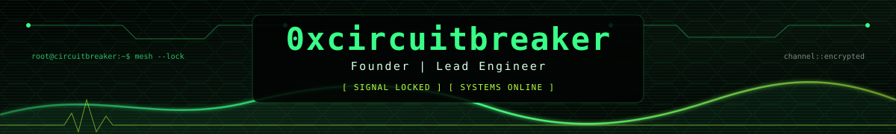
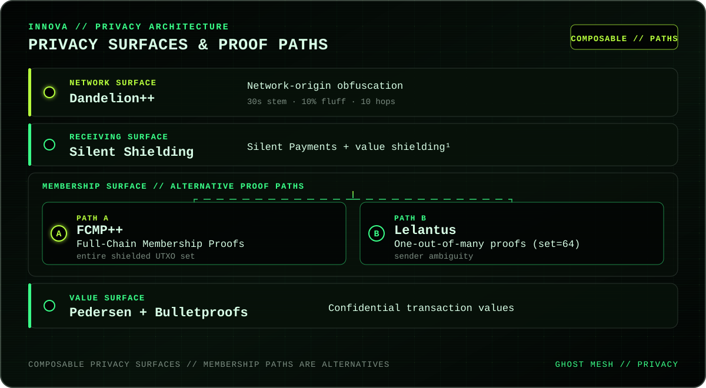
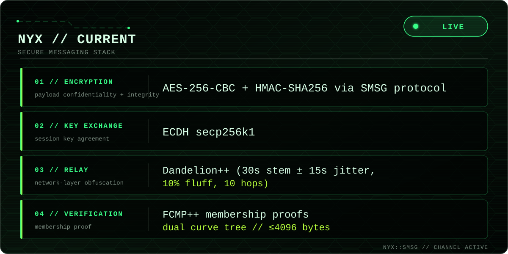
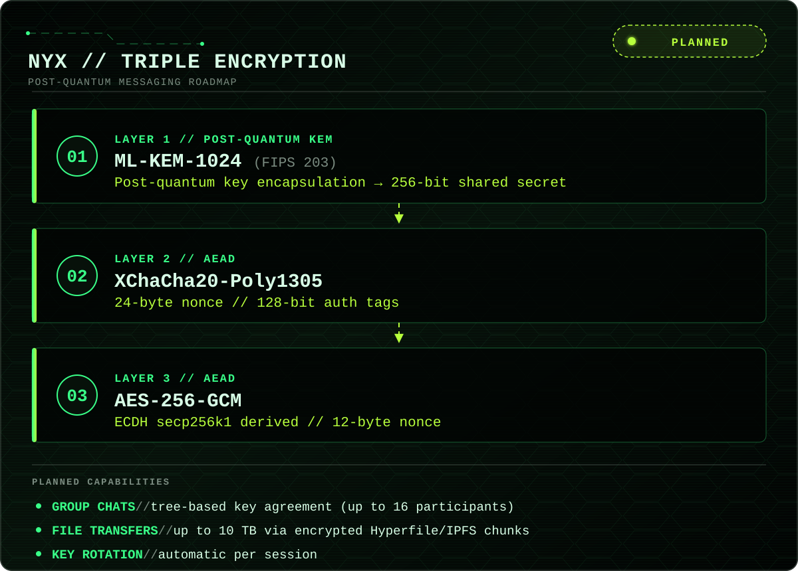
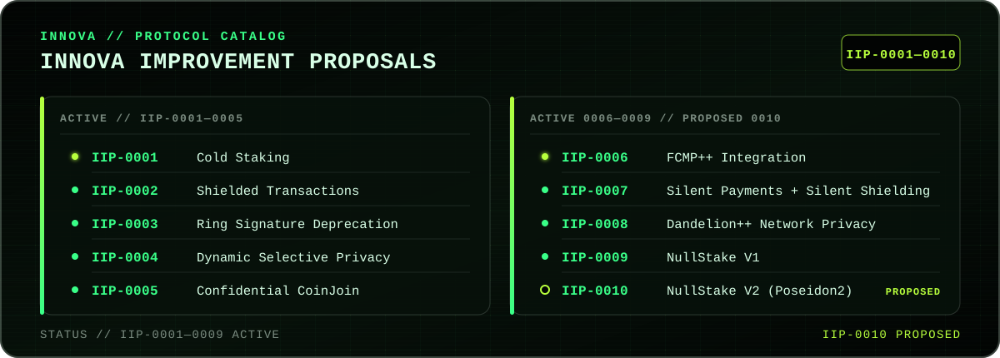
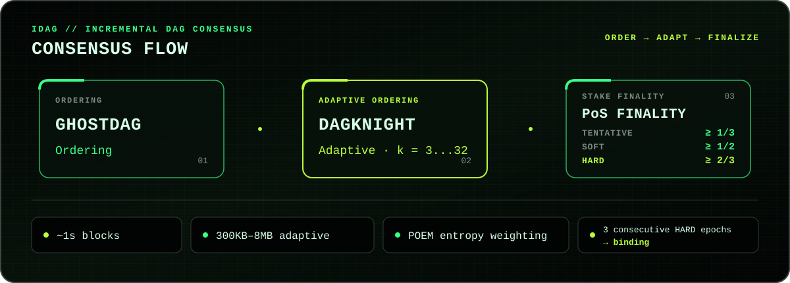
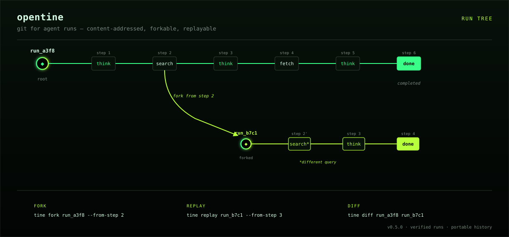
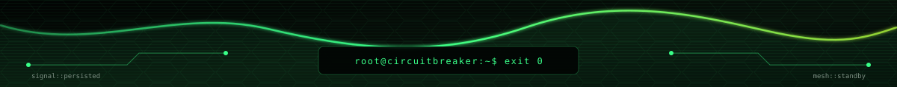

<div align="center">


<a href="https://github.com/0xcircuitbreaker">
  
</a>

<br/>

<a href="https://daedalusdevelopmentgroup.com"></a>

<br/><br/>

<p align="center"><sub><code>Building autonomous AI infrastructure, high-performance DeFi,<br/>and privacy-first blockchain protocols from the ground up.</code></sub></p>

<br/>

<a href="#solidus-network--high-performance-multi-chain-perps-exchange"></a>
<a href="#innova-inn--privacy-first-blockchain-protocol"></a>
<a href="#project-lavalamp--hardware-level-side-channel-mitigation"></a>
<a href="#opentine--git-shaped-provenance-for-agent-runs"></a>

</div>

<br/>

---

<br/>

<div align="center">

<!-- ═══════════════════════════════════════════════════════════════════ -->
<!-- SOLIDUS NETWORK                                                    -->
<!-- ═══════════════════════════════════════════════════════════════════ -->

<div align="center">
<h2>

SOLIDUS NETWORK — High-Performance Multi-Chain Perps Exchange
</h2>


</div>

<br/>

**Solidus Network** is an active-development perpetuals exchange targeting a **multi-algorithm, multi-chain DAGKNIGHT architecture**. The design proposes **4 zones per region**, each mapped to a **different mining algorithm and hardware class** — ASIC, GPU, CPU, and mobile — plus a built-in perps core with on-chain order matching. Performance figures below are engineering targets, not deployed benchmarks.

### DAGKNIGHT Zone-Level DAG Architecture

The target design places DAGKNIGHT consensus **at the zone level** where transaction throughput matters, while Region and Prime chains use **entropic block ordering**.

<p align="center">
  <a href="./assets/readme/solidus-network-topology.svg">
    
  </a>
</p>

### Multi-Algorithm Zone Architecture — Dedicated Hardware Lanes

Each planned region contains **4 parallel zones**, each mapped to a distinct consensus algorithm. The design gives each hardware class a dedicated lane with separately balanced difficulty, from enterprise ASICs down to mobile devices.

| Zone | Algorithm | Hardware Class | Design Goal |
|:---|:---|:---|:---|
| **Zone 1** | SHA-256 | ASIC miners | Maximum hashrate throughput |
| **Zone 2** | ProgPoW | GPU miners (NVIDIA/AMD) | Memory-hard, ASIC-resistant |
| **Zone 3** | RandomX-S | CPU miners | Modified RandomX — breaks Antminer RandomX ASICs |
| **Zone 4** | Panthera | Mobile devices | Lightweight mobile-optimized algorithm |

### Performance Targets

| Metric | Target |
|:---|:---|
| **Throughput** | Hyperliquid-competitive throughput; benchmark pending |
| **Zone Consensus** | Proposed DAGKNIGHT-based ordering |
| **Region/Prime** | Target entropic block ordering without a DAG |
| **Order Matching** | Target sub-second on-chain execution |
| **Finality** | Target zone-level and cross-region finality model |
| **Architecture** | Quai fork — hierarchical, sharded, merged-mined |

### Planned Perps Core

| Feature | Description |
|:---|:---|
| **On-Chain Order Book** | Fully on-chain limit/market order matching — no off-chain sequencer |
| **Cross-Margin** | Unified margin across positions with portfolio-level risk |
| **Liquidation Engine** | MEV-resistant liquidation with keeper incentives |
| **Funding Rates** | Decentralized oracle-fed funding rate mechanism |
| **Multi-Collateral** | Multiple collateral types with real-time mark pricing |

### Tech Stack

<div align="center">


</div>

<br/>

---

<br/>

<!-- ═══════════════════════════════════════════════════════════════════ -->
<!-- INNOVA + IDAG + INVS                                               -->
<!-- ═══════════════════════════════════════════════════════════════════ -->

<div align="center">
<h2>

INNOVA (INN) — Privacy-First Blockchain Protocol
</h2>

<a href="https://innova-foundation.com"></a>&nbsp;
<a href="https://github.com/innova-foundation"></a>

<br/><br/>

[](https://github.com/innova-foundation/innova)
[](https://github.com/innova-foundation/innova)
[](https://github.com/innova-foundation/innova)
[](https://github.com/innova-foundation/innova)

</div>

<br/>

**Innova** is a hybrid PoW/PoS privacy blockchain with **1,500+ commits**, built on the **Tribus** hashing algorithm (three NIST5 algorithms), ~15s block times, and a hardcapped 18M supply. Its protocol combines composable privacy surfaces, a decentralized services layer, and a Collateral Node network.

### Privacy Surfaces & Proof Paths

<p align="center">
  <a href="./assets/readme/innova-privacy-stack.svg">
    
  </a>
</p>

<sub>¹ Silent Shielding: RPC commands registered (`sp_send`, `sp_getnewaddress`);</sub>

### Protocol Features

<table>
<tr>
<td width="50%" valign="top">

**Privacy & Staking**

| Feature | Description |
|:---|:---|
| **NullStake V1** | Sigma protocol anonymous staking (block 7,325,000) |
| **NullStake V2** | Poseidon2 + BPAC compact proofs with viewing-key auditability (block 7,330,000) |
| **NullStake V3** | Enhanced ZK staking circuits (block 7,335,000) |
| **Stealth Addresses** | One-time destination addresses for every transaction |
| **Native Tor** | Built-in onion routing for network-level privacy |
| **Dynamic Selective Privacy** | 8 configurable privacy modes (IIP-0004) |
| **Ring Signatures** | Transaction path obfuscation |

</td>
<td width="50%" valign="top">

**Decentralized Services**

| Feature | Description |
|:---|:---|
| **Nyx** | Encrypted messaging system — currently live with AES-256-CBC + HMAC-SHA256 via SMSG, Dandelion++ relay, and FCMP++ membership proofs. Planned upgrade to triple-layer encryption: ML-KEM-1024 (post-quantum) + XChaCha20-Poly1305 + AES-256-GCM with group chats (16 participants) and 10 TB file transfers via encrypted Hyperfile/IPFS chunks |
| **IDNS** | Blockchain-native DNS — A, AAAA, NS, PTR, MX, TXT, CNAME records anchored on-chain for decentralized service routing |
| **Proof of Data (PoD)** | On-chain timestamped record anchoring via `proofofdata` / `hyperfilepod` RPC — digital artifact integrity verification |
| **Hyperfile** | IPFS-based anonymous file uploads with on-chain integrity references |

</td>
</tr>
</table>

<details>
<summary><b>Nyx Encryption Stack (Detail)</b></summary>

<br/>

**Live now:**
<p align="center">
  <a href="./assets/readme/nyx-current-live.svg">
    
  </a>
</p>

**Proposed upgrade (IIP):**
<p align="center">
  <a href="./assets/readme/nyx-planned-triple-encryption.svg">
    
  </a>
</p>

</details>

<details>
<summary><b>Innova Improvement Proposals (IIPs)</b></summary>

<br/>

<p align="center">
  <a href="./assets/readme/innova-iips.svg">
    
  </a>
</p>

</details>

<details>
<summary><b>Network Specifications</b></summary>

<br/>

| Parameter | Value |
|:---|:---|
| **Algorithm** | Tribus PoW (3x NIST5) + PoS (6% annual) |
| **Block Time** | ~15 seconds |
| **Total Supply** | 18,000,000 INN |
| **Collateral Nodes** | 25,000 INN collateral, 65% block reward |
| **Confirmations** | 10 required, 75 block maturity |
| **Stake Age** | 10-hour minimum |
| **BIP39 Coin Type** | 116 |
| **Ports** | P2P 14530, RPC 14531, CN 14539 |
| **Atomic Swaps** | BIP65 CLTV |
| **Multi-Sig** | Native support |

</details>

<br/>

### IDAG — Incremental DAG Consensus

> *The first block DAG with DAGKNIGHT adaptive ordering, PoS finality, and full zero-knowledge privacy.*

IDAG is Innova's next-generation consensus — a four-phase migration from linear blockchain to a high-throughput block DAG. First to implement **epoch-anchored FCMP++ membership proofs** in a DAG and **adaptive DAGKNIGHT k inference**.

<p align="center">
  <a href="./assets/readme/idag-consensus-flow.svg">
    
  </a>
</p>

| Parameter | Value |
|:---|:---|
| **Block Interval** | ~1 second (post-DAG fork at block 7,950,000) |
| **Block Size** | 300 KB floor – 8 MB ceiling (adaptive median over 1000-block window) |
| **Finality** | `TENTATIVE` (⅓ stake) → `SOFT` (½ stake) → `HARD` (⅔ stake, 3 consecutive epochs) |
| **GHOSTDAG** | Fixed k=18, pre-DAGKNIGHT ordering |
| **DAGKNIGHT** | Adaptive k=3..32 (EMA-inferred, activates at block 8,000,000) |
| **Fork Resolution** | POEM — `GetBlockEntropy()` computes entropy from inverted block hash (staged) |
| **Epoch** | 300 blocks (~5 min), min 2 unique voters for finality |
| **Privacy** | Epoch-anchored FCMP++ membership proofs via dual curve tree (secp256k1 + Ed25519) with deterministic DAG-ordered commits |

<br/>

### INVS — Shielded Asset Protocol

**INVS** is the shielded asset layer within the Innova ecosystem — private value transfer with ZK-proof verification, leveraging Innova's privacy surfaces and IDAG's throughput for confidential transactions.

### Innova Tech Stack

<div align="center">


</div>

<br/>

---

<br/>

<!-- ═══════════════════════════════════════════════════════════════════ -->
<!-- PROJECT LAVALAMP                                                   -->
<!-- ═══════════════════════════════════════════════════════════════════ -->

<div align="center">
<h2>

PROJECT LAVALAMP — Hardware-Level Side-Channel Mitigation
</h2>

&nbsp;
&nbsp;


</div>

<br/>

**Project Lavalamp** is a hardware-software security product that masks the **AMD Zen 5 SMT port contention timing side-channel** — a **27.6% signal leakage** vulnerability that AMD, Google, Microsoft, and NVIDIA all declined to fix. At its core is a proprietary entropy engine that generates high-quality dither patterns to bury timing signals below the detection floor. Validated on live FPGA hardware — **8/8 NIST-class statistical quality tests pass, 98.4% Shannon entropy efficiency**, with integrity sealing across every released bitstream.

### Recent Milestones

- **Hardware validation complete** on the Artix-7 reference platform — full end-to-end signal-masking loop running on live silicon.
- **Shield (software) tier** daemon feature-complete on x86 and ARM Neoverse with 93% leak reduction at ~6% CPU overhead.
- **Lite (USB-FPGA) tier** shipping across 7 Artix-7 boards with 99%+ leak reduction at <1% host overhead.
- **Pro (PCIe) tier** in active development — kernel driver and TLP-inference pipeline under bring-up.
- **Phase 2 porting effort underway** — extending the FPGA build system to 17 boards across 6 vendors.

<p align="center">
  <a href="./assets/readme/lavalamp-architecture.svg">
    
  </a>
</p>

### Three Deployment Tiers

| Tier | Form Factor | Leak Reduction | CPU Overhead |
|:---|:---|:---|:---|
| **Shield** | CPU-only software daemon (x86 / ARM Neoverse) | 93% | 6% |
| **Lite** | USB FPGA bitstream + host daemon — 7+ Artix-7 boards | 99%+ | <1% |
| **Pro** *(in dev)* | PCIe FPGA card + kernel driver + TLP inference | 99%+ | ~0% |

### Universal FPGA Build System

One command per supported board — `vivado -mode batch -source build_board.tcl -tclargs <board>`. Currently shipping on the Artix-7 family; Phase 2 validates across **17 FPGA boards spanning 6 vendors** (AMD/Xilinx, Intel/Altera, Lattice, Gowin, Microchip).

| Vendor | Families | Status |
|:---|:---|:---|
| **AMD / Xilinx** | Artix-7, Kintex-7, Virtex UltraScale+ | 7 boards shipping · Kintex/UltraScale validation in progress |
| **Intel / Altera** | Cyclone V SoC | Planned (Phase 2) |
| **Lattice** | ECP5 | Planned (Phase 2) |
| **Gowin** | GW2A | Planned (Phase 2) |
| **Microchip** | PolarFire SoC | Planned (Phase 2) |

### Vendor Refusal — Why This Product Exists

| Vendor | Tracking ID | Response |
|:---|:---|:---|
| AMD | `AMD-NSACNT3N` | *"Expected Behavior"* |
| Google / Chromium | Issue `475937586` | *"Won't Fix"* |
| Microsoft MSRC | `VULN-171518` | *"Does not meet criteria"* |
| NVIDIA PSIRT | Tracking `5775002` | *"Expected behavior"* |

Disabling SMT mitigates the leak but costs **~50% of compute capacity**. Lavalamp recovers 97% of that capacity while reducing leakage by **93–99%** depending on tier. No other product targets this specific vulnerability at the hardware level.

### Tech Stack

<div align="center">


</div>

<br/>

---

<br/>

<!-- ═══════════════════════════════════════════════════════════════════ -->
<!-- OPENTINE                                                           -->
<!-- ═══════════════════════════════════════════════════════════════════ -->

<div align="center">
<h2>

OpenTine — Git-Shaped Provenance for Agent Runs
</h2>

<p align="center"><strong>Record, verify, fork, compare, attest, and synchronize agent execution history.</strong><br/>
<sub>&le;250-line trusted kernel · Portable v2 artifacts + verified v3 repositories · <strong>Beta v0.5.0</strong> on PyPI</sub></p>

<a href="https://opentine.com"></a>&nbsp;
<a href="https://github.com/0xcircuitbreaker/opentine"></a>&nbsp;
<a href="https://github.com/0xcircuitbreaker/opentine/releases/tag/v0.5.0"></a>&nbsp;
<a href="https://pypi.org/project/opentine/"></a>&nbsp;
<a href="https://github.com/0xcircuitbreaker/opentine/blob/v0.5.0/LICENSE"></a>&nbsp;
<a href="https://pypi.org/project/opentine/"></a>&nbsp;
<a href="https://github.com/0xcircuitbreaker/opentine/actions"></a>

</div>

<br/>

A **tine** is the prong of a fork. OpenTine gives agent execution history Git-shaped provenance without requiring a hosted control plane.

OpenTine v0.5.0 keeps two deliberately separate, compatible storage surfaces:

| Surface | Format | Purpose |
|:---|:---|:---|
| **Portable run** | `*.tine` v2 | Save, sign, verify, fork, replay, diff, resume, tag, search, and migrate individual run trees. Readers still load v1 and v2 artifacts. |
| **Verified repository** | `.tine/` v3 | Store typed content-addressed objects, refs/reflogs, attestations, annotations, packs, semantic diffs, causal context, and synchronized remotes. |

### Quickstart

OpenTine v0.5.0 supports **Python 3.11–3.14**. This example uses the optional Anthropic adapter and expects `ANTHROPIC_API_KEY` in the environment.

```bash
pip install "opentine[anthropic]==0.5.0"
```

```python
from opentine import Agent
from opentine.models.anthropic import Anthropic

agent = Agent(model=Anthropic("claude-sonnet-5"))
run = agent.run_sync("Explain the current branch")
run.save("result.tine")
```

```bash
tine show result.tine
tine verify result.tine
tine cost result.tine
```

### v0.5.0 — Ecosystem Release

Released July 31, 2026, v0.5.0 extends the verified run model into the surrounding agent ecosystem while keeping prior stored data readable. [Read the v0.5.0 changelog →](https://github.com/0xcircuitbreaker/opentine/blob/v0.5.0/CHANGELOG.md)

| Area | Current capability |
|:---|:---|
| **OpenTelemetry GenAI** | Imports modern GenAI spans and complete OTLP/JSON documents; exports portable or repository runs back to matching GenAI spans. |
| **Framework interoperability** | Imports LangChain, LlamaIndex, AutoGen, CrewAI, and OpenAI Agents logs; optional `opentine[langchain]` records LangChain/LangGraph runs live. |
| **Verification** | Content-addressed run history, integrity checks, HMAC-SHA256 and Ed25519 signing, typed links, deep `fsck`, and attestation objects. |
| **Usage and billing** | Normalized provider usage, explicit complete/partial/unknown/unmetered billing states, signed pricing catalogs, and strict cost budgets. |
| **Automation** | `tine import`, stable `--json` output, MCP operations, external CLI harness capture, and a bounded self-hosted reference remote. |
| **Compatibility** | Golden-fixture gates verify that artifacts and repositories written by v0.3.0 and v0.4.0 still load under v0.5.0. |

<p align="center">
  <a href="./assets/readme/opentine-run-tree.svg">
    
  </a>
</p>

### Fork-and-diff workflow

When a run fails after many steps, branch from the last good point and compare the resulting histories:

```bash
tine show failed_run.tine
tine fork failed_run.tine --from-step 3 --save fixed_run.tine
tine diff failed_run.tine fixed_run.tine
```

### Selected CLI surface

The `tine` CLI ships **27 subcommands** across portable artifacts, interoperability, pricing, verified repositories, and self-hosted synchronization.

```bash
# Portable artifacts
tine run <script.py> --save result.tine
tine show result.tine
tine verify result.tine --json
tine fork result.tine --from-step 3 --save fork.tine
tine replay result.tine --from-step 3 --mode cache --save replay.tine
tine diff result.tine fork.tine

# Verified repository and trace interoperability
tine init .
tine migrate-v3 result.tine --repo . --ref heads/main
tine import trace.json --format otel-json --repo . --ref heads/imported
tine fsck --repo .
```

### Built-in tools and policy boundaries

Tools remain ordinary typed Python callables, but host-owned policy objects control filesystem, network, shell, and Python execution boundaries.

| Capability | Symbols | Default boundary |
|:---|:---|:---|
| **Web** | `web.fetch`, `web.fetch_raw` | Scheme, DNS, redirect, body-size, and timeout checks. |
| **Search** | `search.search` | Bounded Tavily, Exa, Brave, or DuckDuckGo retrieval. |
| **Filesystem** | `fs.read`, `fs.write`, `fs.edit`, `fs.ls` | Scoped roots; writes require an allowed write root. |
| **Execution** | `shell.run`, `python.execute` | Disabled until the embedding host supplies an explicit enabling policy. |

[Read the v0.5.0 security model →](https://github.com/0xcircuitbreaker/opentine/blob/v0.5.0/docs/SECURITY_MODEL.md)

### Model and ecosystem support

| Surface | Coverage |
|:---|:---|
| **Native adapters** | Anthropic, OpenAI Responses API, Google Gemini, and Ollama. |
| **Hosted compatible adapters** | Kimi/Moonshot, DeepSeek, GLM/Z.AI, xAI/Grok, Groq, Qwen, Together, Mistral/Ministral, OpenRouter, and Nous/Hermes. |
| **Local and generic runtimes** | LM Studio, vLLM, Unsloth, llama.cpp, LocalAI, Jan, SGLang, TGI, MLX-LM, NVIDIA NIM, TensorRT-LLM, KoboldCpp, LiteLLM, and exact-base OpenAI-compatible servers. |
| **Trace ecosystems** | OpenTelemetry GenAI, LangChain/LangGraph, LlamaIndex, AutoGen, CrewAI, and OpenAI Agents. |

Unknown model identifiers remain runnable through their supported transport and are reported as **unpriced** rather than receiving a guessed cost.

### Tech Stack

<div align="center">


</div>

<br/>

---

<br/>


<!-- ═══════════════════════════════════════════════════════════════════ -->
<!-- FULL TECH STACK                                                    -->
<!-- ═══════════════════════════════════════════════════════════════════ -->

<div align="center">
<h2>

Full Tech Stack
</h2>
</div>

<div align="center">

#### Languages


#### Cryptography & Privacy


-0d1117?style=for-the-badge)


#### Consensus & Networking


#### Infrastructure


</div>

<br/>

---

<br/>

<!-- ═══════════════════════════════════════════════════════════════════ -->
<!-- GITHUB ANALYTICS                                                   -->
<!-- ═══════════════════════════════════════════════════════════════════ -->

<div align="center">
<h2>

GitHub Analytics
</h2>


<br/>


<br/><br/>


</div>

<br/>

---

<br/>

<!-- ═══════════════════════════════════════════════════════════════════ -->
<!-- PINNED REPOS                                                       -->
<!-- ═══════════════════════════════════════════════════════════════════ -->

<div align="center">
<h2>

Pinned Repositories
</h2>

</div>

<table>
<tr>
<td width="50%" valign="top">
<h3><a href="https://github.com/innova-foundation/innova">innova-foundation/innova</a></h3>
<p>Privacy-first hybrid PoW/PoS blockchain with collateral nodes, native Tor, selective privacy, and IDAG research.</p>
<p>
<a href="https://github.com/innova-foundation/innova"></a>
<a href="https://github.com/innova-foundation/innova/forks"></a>
<a href="https://github.com/innova-foundation/innova/commits"></a>
</p>
</td>
<td width="50%" valign="top">
<h3><a href="https://github.com/0xcircuitbreaker/opentine">0xcircuitbreaker/opentine</a></h3>
<p>Git for agent runs: content-addressed execution trees that can be forked, replayed, diffed, paused, and resumed.</p>
<p>
<a href="https://pypi.org/project/opentine/"></a>
<a href="https://github.com/0xcircuitbreaker/opentine"></a>
<a href="https://github.com/0xcircuitbreaker/opentine/commits"></a>
</p>
</td>
</tr>
</table>

<br/>

---

<br/>

<!-- ═══════════════════════════════════════════════════════════════════ -->
<!-- ADDITIONAL ECOSYSTEM                                               -->
<!-- ═══════════════════════════════════════════════════════════════════ -->

<details align="center" open>
<summary><h3>Additional Research</h3></summary>

<br/>

**MEV & Ethereum Infrastructure** — Block builder tooling (Rust), P2P mempool crawlers, EVM benchmarking, and DeFi protocol analysis.

**Cryptanalysis & Bitcoin Research** — UTXO analysis, chainstate parsing, vanity address generation, and parallel cryptanalysis tooling.

**Priscus Research** — Applied AI systems research under private development. Public releases will focus on verifiable claims, reproducible evaluation summaries, and externally reviewable findings while keeping proprietary code, architecture details, model weights, datasets, and internal design materials confidential.

**AI/ML** — Autonomous agent architectures, multimodal models, and research aligned with agent-first design philosophy.

</details>

</div>

<br/>

---

<div align="center">

<br/>

<sub>Building autonomous AI infrastructure, high-performance DeFi, and privacy-first blockchain protocols.</sub>

<br/><br/>



</div>
